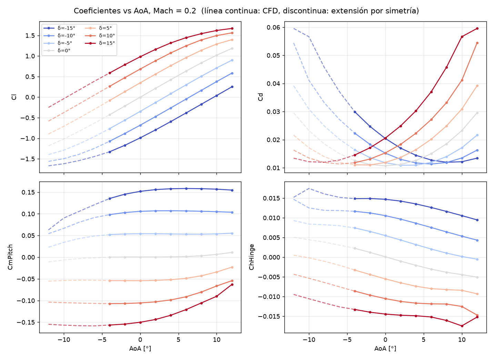
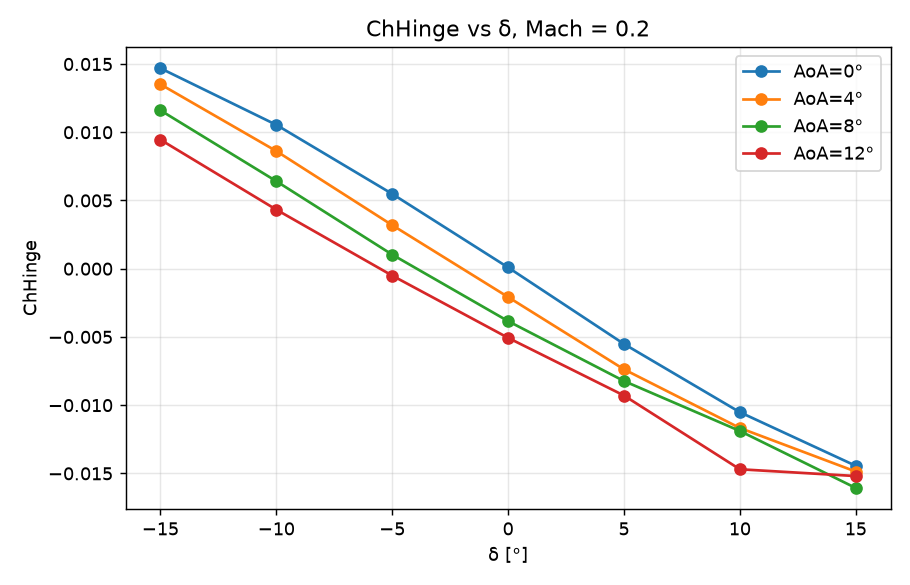
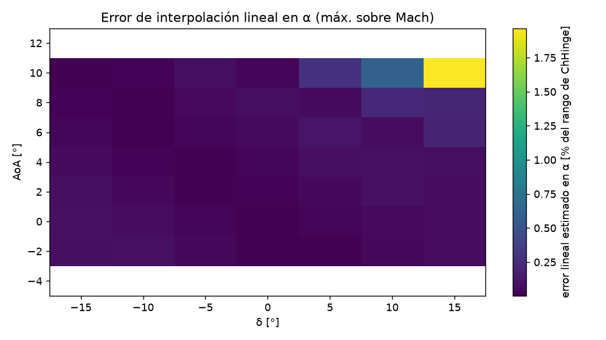

# LUT de cargas aerodinámicas (barrido CFD estático)

Tabla de búsqueda para el banco de ensayos de actuadores de superficies de control. Se construye a partir de
`resultados.csv` (315 simulaciones CFD estáticas) y entrega los coeficientes aerodinámicos y el momento de
bisagra en función de **δ** (deflexión de la superficie), **Mach** y **AoA**.

## 1. Archivos

| Archivo | Contenido |
|---|---|
| `lut_cargas.csv` | LUT en formato largo (455 filas). Columna `origen`: `cfd` o `simetria` |
| `lut_cargas.mat` | LUT para MATLAB: ejes `delta_deg`, `mach`, `aoa_deg`; arreglos 3D `Cl`, `Cd`, `CmPitch`, `ChHinge`, `HingeMoment_Nm` con dimensiones **(δ, Mach, AoA)** = (7, 5, 13); `K_hinge`; `origen` |
| `build_lut.py` | Script que reproduce todo (LUT, validaciones, figuras y este documento) |
| `figuras/` | Gráficos referenciados abajo |

## 2. Estructura de la LUT

| Eje | Valores | Paso | Nº |
|---|---|---|---|
| δ [°] | -15 a 15 | 5 | 7 |
| Mach | 0.1 a 0.3 | 0.05 | 5 |
| AoA [°] (CFD) | -4 a 12 | 2 | 9 |
| AoA [°] (LUT extendida) | -12 a 12 | 2 | 13 |

Variables: `Cl`, `Cd`, `CmPitch`, `ChHinge` (adimensionales) y `HingeMoment_Nm` (N·m).
Los 315 puntos de CFD se conservan **sin modificar**; los 140 puntos restantes
(-12° ≤ AoA ≤ -6°) provienen de la simetría del perfil (sección 4).

## 3. Datos de origen y verificación de la grilla

- Grilla completa: 7 × 5 × 9 = 315 puntos, sin valores nulos ni duplicados.
- Orden de datos: se ordenó por (δ, Mach, AoA) antes de armar los arreglos 3D.

## 4. Extensión del rango de AoA por simetría

El perfil es simétrico, por lo que (δ, α) y (−δ, −α) son configuraciones espejo. Para los puntos nuevos:

- `Cl`, `CmPitch`, `ChHinge`: f(δ, M, α) = −f(−δ, M, −α)
- `Cd`: f(δ, M, α) = +f(−δ, M, −α)

Esto se aplica solo donde falta CFD (AoA < -4°). En la zona donde existen ambos (AoA entre
-4° y 4°) se mantiene el dato CFD. **Los puntos extendidos heredan el error numérico del
punto CFD espejo** y no son simulaciones independientes: conviene marcarlos como tales (columna `origen`).

Comprobación de la simetría con los datos CFD (85 pares espejo disponibles, con AoA entre
-4° y 4°):

| Variable | Residuo medio | Residuo máx. | Máx. como % del rango |
|---|---|---|---|
| Cl | 3.65e-03 | 1.24e-02 | 0.41 % |
| Cd | 1.15e-04 | 4.68e-04 | 0.51 % |
| CmPitch | 6.21e-04 | 1.83e-03 | 0.57 % |
| ChHinge | 9.54e-05 | 2.93e-04 | 0.75 % |

## 5. Momento de bisagra

`HingeMoment_Nm` en el CSV original cumple **HingeMoment_Nm = K · Mach² · ChHinge**, con

**K = 425.5801 N·m** (error relativo máximo del ajuste: 9.4e-06).

Es decir, el momento dimensional solo agrega la presión dinámica; la información aerodinámica está en `ChHinge`.
K = ½·ρ·a²·(S·c) para los valores de referencia usados al post-procesar. Como chequeo de plausibilidad:
si usaste ρ = 1.225 kg/m³ y a = 340.294 m/s (ISA nivel del mar), resulta S·c = 0.00600 m³;
verifícalo contra tu post-procesado (ver pendientes, sección 10).

En la LUT, `HingeMoment_Nm` se recalcula como K·M²·ChHinge para todos los puntos (en los puntos CFD coincide con el
original, diferencia máxima 6.3e-06 N·m). Para emular otras condiciones (otra altitud, otra velocidad,
otra escala) usa `ChHinge` y recalcula el momento con tu propia presión dinámica en vez de `HingeMoment_Nm`.

**Dependencia de ChHinge con Mach:** en este rango la variación de ChHinge entre M = 0.1 y M = 0.3
(a δ y AoA fijos) tiene mediana 3.2e-04 (0.81 % del rango total de ChHinge)
y máximo 1.1e-02 (28.8 %) en δ=15°, α=12°.
Casi toda la variación de `HingeMoment_Nm` con Mach es, por tanto, el factor M².

## 6. Forma de las curvas





## 7. Error de interpolación esperado

Se estimó con *leave-one-out* sobre los datos CFD: se quita cada punto interior, se interpola linealmente con sus
dos vecinos a lo largo de un eje y se compara con el valor simulado. Como ese vecino está a doble distancia, el error
de ese ensayo es unas 4 veces mayor que el error máximo de interpolación lineal dentro de una celda de la grilla
(aproximación válida en zonas suaves). Errores expresados como % del rango total de la variable
(ChHinge: 0.0392; Cl: 3.042).

| Variable | Eje | Mediana | P95 | Máx. | Punto del máximo |
|---|---|---|---|---|---|
| ChHinge | delta | 0.657 % | 1.493 % | 8.78 % | δ=10°, M=0.25, α=12° |
| ChHinge | mach | 0.016 % | 0.102 % | 6.35 % | δ=15°, M=0.25, α=12° |
| ChHinge | alpha | 0.185 % | 0.887 % | 7.86 % | δ=15°, M=0.25, α=10° |
| Cl | delta | 0.336 % | 1.430 % | 1.71 % | δ=10°, M=0.3, α=8° |
| Cl | mach | 0.011 % | 0.136 % | 0.80 % | δ=15°, M=0.15, α=12° |
| Cl | alpha | 0.128 % | 0.639 % | 1.03 % | δ=15°, M=0.25, α=10° |

Puntos con mayor error en α para ChHinge (error de celda estimado = LOO / 4):

| Punto | ChHinge | Error de celda estimado |
|---|---|---|
| δ=15°, M=0.25, α=10° | -0.01748 | 7.71e-04 (1.97 %) |
| δ=15°, M=0.1, α=10° | -0.01753 | 6.20e-04 (1.58 %) |
| δ=15°, M=0.3, α=10° | -0.01749 | 4.61e-04 (1.17 %) |
| δ=15°, M=0.2, α=10° | -0.01744 | 4.52e-04 (1.15 %) |
| δ=15°, M=0.15, α=10° | -0.01737 | 2.52e-04 (0.64 %) |
| δ=10°, M=0.1, α=10° | -0.01248 | 2.41e-04 (0.61 %) |
| δ=10°, M=0.15, α=10° | -0.01249 | 2.29e-04 (0.58 %) |
| δ=10°, M=0.2, α=10° | -0.01251 | 1.97e-04 (0.50 %) |



Lectura: la tabla es casi lineal en la mayor parte del dominio, y el error se concentra en δ grande con AoA alto, donde
las curvas dejan de ser lineales (compatible con el inicio de separación del flujo; esto es una hipótesis hasta
revisar la convergencia de esos casos). Si se aumenta la densidad del barrido, es ahí donde más rinde.

Los puntos de borde (δ = ±15° y α = 12°) no se pueden evaluar con este método, y justo ahí está el
comportamiento más irregular. En δ = 15°, α = 12° Cd cae y luego sube con Mach, y ChHinge invierte su
tendencia; con Mach creciente, Cd es no monótono solo en 1 de las 63 combinaciones (δ, α) y ChHinge en 7
(en las demás, con variaciones mucho menores), y ninguna otra tiene una amplitud comparable:

| Mach | Cl | Cd | ChHinge |
|---|---|---|---|
| 0.1 | 1.6693 | 0.1011 | -0.02401 |
| 0.15 | 1.6942 | 0.0834 | -0.02073 |
| 0.2 | 1.6701 | 0.0596 | -0.01520 |
| 0.25 | 1.6469 | 0.0427 | -0.01272 |
| 0.3 | 1.6571 | 0.0453 | -0.01522 |

Es la zona a revisar primero (convergencia de la solución, sensibilidad a la malla, posible flujo separado/inestable)
antes de confiar en la tabla ahí; conviene limitar el envelope del banco o densificar esa esquina.

## 8. Uso

**Reglas generales:** interpolación lineal trilineal; fuera del rango (δ, Mach, AoA) no hay extrapolación
(devolver NaN y que el banco sature o dispare una alarma).

MATLAB:

```matlab
L  = load('lut_cargas.mat');
F  = griddedInterpolant({L.delta_deg(:), L.mach(:), L.aoa_deg(:)}, L.ChHinge, 'linear', 'none');
Ch = F(7, 0.22, 3.5);                  % delta [deg], Mach, AoA [deg]
HM = L.K_hinge * 0.22^2 * Ch;          % momento de bisagra [N m] con la q de la CFD
```

Python:

```python
import numpy as np, pandas as pd
from scipy.interpolate import RegularGridInterpolator
t = pd.read_csv("lut_cargas.csv").sort_values(["delta_deg", "mach", "aoa_deg"])
d, m, a = (np.sort(t[c].unique()) for c in ("delta_deg", "mach", "aoa_deg"))
Ch = t["ChHinge"].values.reshape(len(d), len(m), len(a))
F = RegularGridInterpolator((d, m, a), Ch, bounds_error=False, fill_value=np.nan)
F([[7.0, 0.22, 3.5]])
```

Verificaciones hechas con `build_lut.py`: el interpolador reproduce los 455 nodos (error máx. 0.0e+00);
el archivo `.mat` se recarga idéntico; para ChHinge, la interpolación en 2000 puntos aleatorios espejo (δ, M, α) vs
(−δ, M, −α) con |α| ≤ 4° da una asimetría máxima de 2.7e-04. El código MATLAB de arriba **no se ejecutó**
(no hay MATLAB/Octave en el entorno de generación): pruébalo con un punto conocido de la tabla.

## 9. Limitaciones

- **Cuasi-estática:** no incluye efectos no estacionarios ni histéresis. Para un escenario (δ(t), α(t), M(t)) se evalúa
  la tabla instante a instante.
- **Zona de separación:** con δ y AoA altos la solución estática puede ser poco confiable (convergencia, oscilaciones);
  conviene revisar esos casos antes de usarlos como referencia (sobre todo δ = 15°, α = 12°, ver sección 7).
- **Rango cubierto:** δ ∈ [-15°, 15°], Mach ∈ [0.1, 0.3], AoA ∈ [-12°, 12°] (con extensión por simetría; CFD real en [-4°, 12°]).
- **Puntos por simetría:** no son simulaciones independientes (sección 4).

## 10. Pendientes por completar

Estos datos no se pueden deducir del CSV; conviene registrarlos aquí para que la LUT sea trazable:

| Pendiente | Valor |
|---|---|
| Convención de signo de δ, α y ChHinge | COMPLETAR |
| Definición de ChHinge (normalización, S y c de referencia, eje de bisagra) | COMPLETAR |
| ρ y a de referencia usadas para el momento (para verificar K) | COMPLETAR |
| Dimensionalidad del caso (2D por unidad de envergadura o 3D) y envergadura de la superficie | COMPLETAR |
| Solver, modelo de turbulencia y criterio de convergencia | COMPLETAR |
| Estudio de independencia de malla y validación contra datos del NACA 0012 | COMPLETAR |
